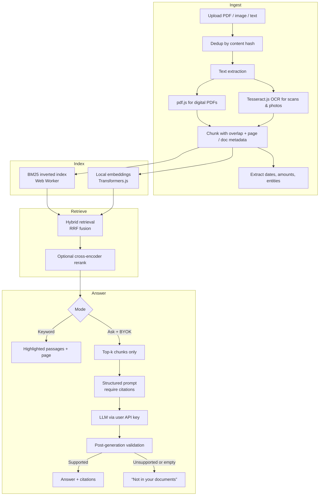

# PaperMind

**Production-grade personal document memory with grounded, citation-enforced AI answers.**

PaperMind is a local-first library for the documents that matter in real life — receipts, warranties, insurance policies, leases, bills, and manuals. It combines on-device hybrid retrieval (BM25 + vector) with optional retrieval-augmented generation so you can ask natural-language questions and get answers that are grounded in your files, with page-level citations. The full library never leaves your browser. Generative answers use your own API key and only the few passages already retrieved for that question.

It is deliberately not a general chat-with-PDF tool. The job is narrower and more useful: keep personal papers organized, find the exact evidence, and answer questions without inventing facts.

## Why this is different from generic Ask-My-Docs

| | Generic chat-with-PDF | PaperMind |
|---|---|---|
| Scope | Any document | Personal life documents (receipts, warranties, policies, bills) |
| Retrieval | Often pure vector or simple keyword | BM25 + vector hybrid with fusion |
| Answer contract | Free-form generation | Strict citation enforcement + post-generation validation |
| Failure mode | Hallucination risk | Explicit “not in your documents” |
| Privacy | Usually upload everything | Local storage + BYOK (only retrieved chunks leave) |
| Evaluation | Rarely measured | Golden dataset + faithfulness / citation coverage gates |
| Habit | One-off chat | Library + dates + reminders + search that still works without AI |

## Core design principles

- **Grounded or silent** — Every factual claim must be supported by a retrieved passage. Unsupported answers are rejected.
- **Hybrid retrieval by default** — Exact tokens (policy numbers, amounts, model codes) and semantic meaning are both first-class. Neither is optional.
- **Citation enforcement** — Machine-readable citations, validated after generation. The UI only shows an answer if the citations check out.
- **Small, precise context** — The model never sees the full library. It sees a handful of already-retrieved chunks.
- **Measurable quality** — A golden question set is the source of truth. Changes to retrieval or prompts are gated on faithfulness and citation coverage.
- **Graceful degradation** — Search and the library work with zero API key. AI is an optional layer on top of retrieval that already works.

## Architecture



### Pipeline stages

1. **Ingestion**
   - File type detection and content-hash deduplication.
   - Text extraction: pdf.js for selectable PDFs, Tesseract.js for images and scanned pages (on-device).
   - Deterministic chunking with overlap; each chunk carries document id, page, and source offsets.
   - Lightweight extraction of dates, amounts, and policy/receipt identifiers for the “upcoming” and metadata views.

2. **Indexing**
   - BM25 inverted index built in a Web Worker so the main thread stays responsive.
   - Local embeddings (small model via Transformers.js) stored in IndexedDB. No document text is sent for embedding.

3. **Hybrid retrieval**
   - Parallel BM25 and vector search.
   - Reciprocal Rank Fusion (or weighted combination) to merge the lists.
   - Optional lightweight cross-encoder rerank on the fused top candidates for higher precision on short personal documents.

4. **Generation (optional, BYOK)**
   - Only the top retrieved chunks + the user question are sent.
   - Structured prompt requires every claim to cite a chunk id / page.
   - Post-generation validator checks that cited chunks actually support the claim. Failures become “not in your documents.”
   - Key is held only in the browser and is sent directly to the provider (OpenAI, Anthropic, or compatible endpoint).

## Key engineering features

- **BM25 + vector hybrid** — Solves the classic failure modes: pure vector misses exact IDs and amounts; pure keyword misses paraphrases.
- **Strict citation enforcement** — Machine-readable citations, validated after the model returns. The UI never displays an unsupported answer.
- **Explicit failure mode** — No relevant context or failed validation → clear “not in your documents” instead of a plausible hallucination.
- **On-device everything by default** — OCR, chunking, BM25, embeddings, and storage stay in the browser. AI is an opt-in layer.
- **BYOK privacy boundary** — Same pattern as privacy-conscious tools: personal key goes straight to the provider; the project never sees the key or the full library.
- **Golden dataset + quality gates** — Small, curated set of questions with expected documents and pages. Used to measure faithfulness, context precision/recall, and citation coverage before merging retrieval or prompt changes.
- **Versioned prompts** — Prompts live in files, treated as code, and changed only with evaluation evidence.
- **Observability (local)** — Structured logs of query, retrieved scores, citations, and latency (stays on device).
- **Incremental indexing** — New documents are chunked and indexed without rebuilding the entire store.

## Evaluation strategy

A golden dataset (target 50–150 question–answer pairs drawn from real receipt, warranty, and policy examples) is the regression suite.

Metrics (Ragas-style or equivalent):
- Faithfulness (answer supported by retrieved context)
- Context precision / recall
- Citation coverage (every claim has a valid source)
- “Not found” accuracy on questions that should return no evidence

Changes to chunking, fusion weights, reranking, or the generation prompt must not regress these thresholds. The evaluation can run in CI once the core retrieval path exists.

## Privacy model

| Mode | What leaves the device | Who is billed |
|------|------------------------|---------------|
| Library + keyword search | Nothing | Nobody |
| Ask (BYOK) | Only the retrieved chunks for that question + the question | User’s own API account |
| Optional shared demo | Same retrieved chunks (never the full library) | Limited project allowance |

No user accounts. Originals, extracted text, embeddings, and the BM25 index live in IndexedDB. Export is a single ZIP of originals + metadata so the user can leave at any time.

## Status

This is an early-stage product repository. The design, privacy boundary, and evaluation approach are decided. Implementation is planned in the order below.

| Milestone | Scope |
|-----------|-------|
| 1. Library | Import, OCR, BM25 search with highlights, document viewer, tags, important dates, ZIP export/import |
| 2. Hybrid + Ask | Local embeddings, RRF fusion, BYOK generation, citation parsing + validation, golden-set runner |
| 3. Polish | Upcoming dates view, calendar export, backup reminders, optional local small-model generation |

## Intended project layout

```text
src/
  ingest/          type detection, OCR, chunking, date/amount extraction
  index/           BM25 worker, local embeddings, incremental updates
  retrieve/        hybrid fusion, optional rerank
  ask/             versioned prompts, citation parser, support validator
  storage/         IndexedDB schema for docs, chunks, embeddings, dates
  ui/              library, viewer, ask panel, upcoming, settings
eval/
  golden.json      questions + expected document + page + answer constraints
  run.ts           local evaluation runner
  thresholds.json  faithfulness / citation gates
```

## Tech direction

| Component | Technology | Purpose |
|-----------|------------|---------|
| UI | React / TypeScript | Library, viewer, ask interface |
| PDF text | pdf.js | Digital PDF extraction |
| OCR | Tesseract.js | Scans and photos, on-device |
| Storage | IndexedDB | Documents, chunks, embeddings, metadata |
| Lexical search | Custom BM25 (Web Worker) | Exact IDs, amounts, phrases |
| Embeddings | Transformers.js (small local model) | Semantic retrieval without upload |
| Fusion | Reciprocal Rank Fusion | Combine BM25 + vector |
| Generation | User API key (OpenAI-compatible or Anthropic) | Optional grounded answers |
| Evaluation | Golden set + Ragas-style metrics | Prevent silent quality drops |

## Setup (once milestone 1 exists)

```bash
pnpm install
pnpm dev
```

1. Drop a warranty PDF or receipt photo.
2. Confirm keyword search highlights the correct passage and page.
3. Add an expiry date and export to calendar.
4. Paste your API key in settings (stored only in the browser).
5. Ask “when does this warranty end?” — the answer must cite the page.
6. Ask something not in the file — the response must be “not in your documents.”

Always export a ZIP before clearing browser data. Browser storage is not a permanent archive.

## What this is not

- Not a general-purpose chatbot or company knowledge base.
- Not a claim that the model has “read” your entire library. It only sees what retrieval returned.
- Not legal, tax, medical, or insurance advice. It surfaces what your documents say and where.
- Not a product that uploads your files to answer a question.

## Roadmap

1. Solid local library + BM25 + dates + ZIP (usable without any AI).
2. Hybrid retrieval + citation-enforced BYOK Ask + golden-set evaluation.
3. Upcoming view, calendar export, and backup nudges.
4. Optional fully local small-model generation under the same citation rules.

## License

MIT

## Contributing

- Open an issue for larger changes.
- If you modify chunking, retrieval, fusion, or prompts, update or add golden examples and show the evaluation result.
- Do not merge a drop in faithfulness or citation coverage.
- Keep prompts in versioned files.
- Never add a code path that uploads the full library.
